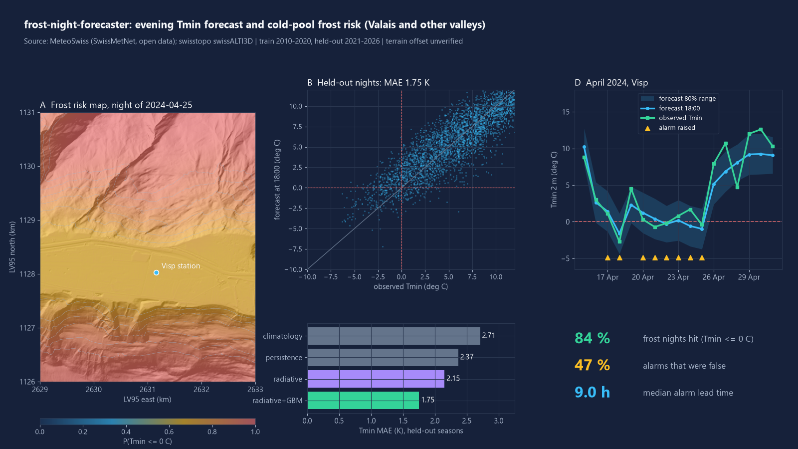
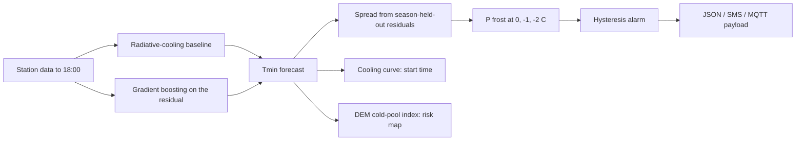

# frost-night-forecaster

An evening forecast of tonight's minimum temperature and frost probability for vineyards and orchards: it flagged 84% of frost nights on held-out springs, with 47% of its alarms false.



## What it does
- Takes the 18:00 weather-station readings (temperature, dew point, wind, cloudiness proxy, 5 cm temperature) and forecasts the night's 2 m minimum (Tmin) until 09:00.
- Combines a radiative-cooling baseline with gradient boosting, and gives a frost probability for 0, -1 and -2 C from a spread estimated on whole held-out training seasons.
- Raises an alarm with hysteresis (fewer on/off flips between updates), re-evaluated at 18:00, 21:00 and 00:00.
- Estimates when to start frost protection from a learned night cooling curve (2 m air reaching +1 C).
- Builds an alarm JSON, an SMS text (<= 160 chars) and an MQTT-style payload. It only builds them; you publish them.
- Downscales the forecast onto a 10 m terrain grid (cold-air-pooling index from a DEM) to draw a frost risk map.

## Results
Six stations in Valais, Vaud, Ticino and Graubuenden (Sion, Visp, Aigle, Nyon/Changins, Magadino, Chur). March-May nights, trained on 2010-2020, tested on **2021-2026** (3304 held-out nights, 350 with Tmin <= 0 C). The alarm threshold was fixed on training seasons only.

| Tmin MAE at 18:00 (K) | |
|---|---|
| Climatology | 2.71 |
| Persistence (tonight's 18:00 temperature) | 2.37 |
| Radiative-cooling baseline | 2.15 |
| Ridge regression | 1.82 |
| **Baseline + gradient boosting** | **1.75** |

Later updates are more accurate: 1.59 K at 21:00 and 1.24 K at 00:00.

| Frost (Tmin <= 0 C), 18:00 alarm | Model | Persistence rule | Baseline rule |
|---|---|---|---|
| Hit rate | 84% | 56% | 61% |
| False alarm ratio | 47% | 45% | 44% |

- Model Brier score 0.051 (climatological rate 0.095).
- Alarm threshold p_on = 0.19, set on training seasons to reach about 85% recall. The 47% false alarms are the price of that choice.
- Median lead time between the alarm and the first observed crossing of 0 C: 9.0 h (interquartile 6.5-11.1 h).
- The start-protection time (reaching +1 C) is within 2 h of the observed time on 50% of nights (MAE 2.2 h): a rough guide, not a precise one.
- Hysteresis cuts alarm toggles from 340 to 144 over the test seasons.
- April 2024 cold spell (15 Apr-1 May): 7 frost nights across the six stations, all alarmed, with 23 false alarms.
- Deeper frosts are harder: hit rate 79% at -1 C and 75% at -2 C.

## Quick start
```bash
pip install -e ".[dev]"
python -m frost_night_forecaster demo --out .        # trains, evaluates, writes docs/ and results/ (a few minutes on CPU)
python -m frost_night_forecaster forecast --station VIS --night 2024-04-18
pytest -q -p no:asyncio
```
`forecast` prints the alarm JSON (see `docs/example_alarm.json`). `fetch-met` and `fetch-dem` rebuild the committed data files from the public sources (network needed; `fetch-dem` needs `pip install -e ".[fetch]"`).

## How it works

- The baseline is a physical cooling estimate from dew point depression, wind and cloudiness (global radiation against clear-sky). Boosting learns the remaining error.
- The spread is estimated separately for clear and cloudy afternoons.
- The map is the station forecast plus a terrain offset: cold air pools in hollows and on valley floors on calm clear nights, and a regional gradient between stations adjusts for height.

## Data sources
- Hourly station data: MeteoSwiss SwissMetNet, open data (`ogd-smn`), spring months 2010-2026. Licence CC BY (STAC collection `ch.meteoschweiz.ogd-smn`; opendata.swiss "Open use, must provide the source"). Source: MeteoSwiss.
- Terrain: swisstopo swissALTI3D (2 m, averaged to 10 m), a 4 x 5 km window around Visp. Terms: opendata.swiss "Open use, must provide the source" (free, including commercial use). Source: Federal Office of Topography swisstopo.
- Committed data is about 4 MB (`frost_night_forecaster/data/`).

## What is not verified yet
- The risk map's terrain offset (1.5 C between the most and least pooling-prone terrain on a calm clear night) is an assumption. No field loggers were used to check the map.
- The frost threshold is 2 m air temperature at a station. Bud damage depends on bud stage and on the temperature at the plot, which can differ by several degrees.
- The 47% false alarms belong to one threshold chosen for recall. Growers with cheap protection may accept more.
- Results for sites far from a station, or outside these valleys, are untested.
- Alarm delivery (SMS, MQTT) is a payload only and has not been tested against a broker or gateway.
- Not a certified warning service. Check official forecasts too.

## Licence
MIT, Copyright (c) 2026 VB-Builds.
